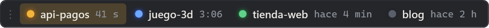
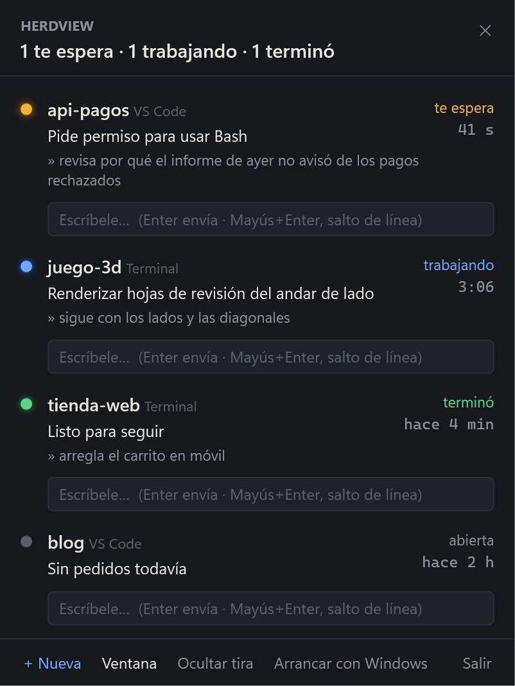
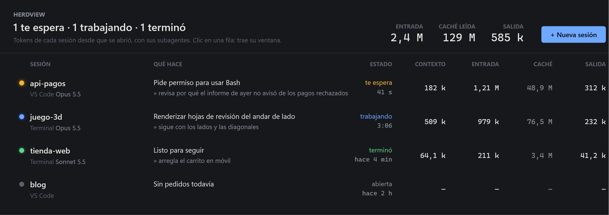
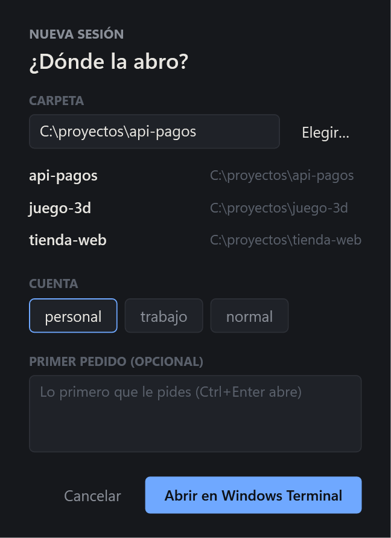
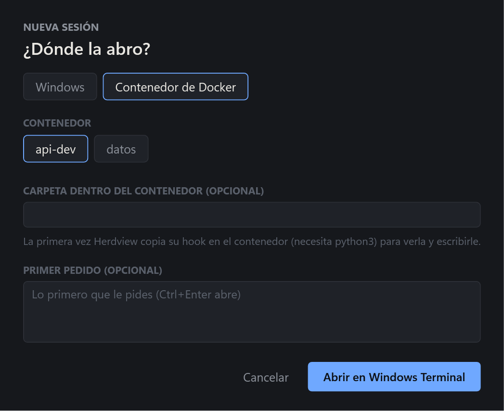

# Herdview

Todas las sesiones de [Claude Code](https://code.claude.com) abiertas en tu PC, de un vistazo: qué hace cada una,
cuáles te esperan y cuáles terminaron. Funciona igual con la terminal que con la extensión de VS Code. Solo Windows.





- **Tira siempre encima.** Una ficha por sesión con su luz: azul trabajando, ámbar te espera (parpadea), verde
  terminó sin que lo hayas visto, gris en reposo. No roba el foco ni sale en Alt+Tab. Clic en una ficha → trae al
  frente la ventana de esa sesión (Windows Terminal, consola o VS Code). El asa `⋮` la mueve (arrastrar) o abre el panel.
- **Panel** (clic en el icono de la bandeja): cada sesión con lo que está haciendo, lo último que le pediste y una
  caja para **escribirle sin cambiar de ventana**: si había terminado, se despierta con tu mensaje; si está
  trabajando, lo recibe al acabar.
- **Ventana con el consumo** (doble clic en el icono de la bandeja, o «Ventana» en el panel): todas las sesiones
  como filas de un tablero, con el modelo, el contexto actual y los tokens de entrada, caché leída y salida de cada
  una (subagentes incluidos), y los totales arriba. Lo saca de la transcripción de cada sesión, leyendo solo lo nuevo.

  

- **Abrir sesiones nuevas** («+ Nueva sesión» en la ventana, «+ Nueva» en el panel o en el menú de la bandeja):
  eliges la carpeta (o una de las recientes), la cuenta de Claude Code (`.claude` y cada `.claude-<nombre>`, vía
  `CLAUDE_CONFIG_DIR`) y, si quieres, el primer pedido; se abre una pestaña de Windows Terminal con Claude arrancado.

  

- **Contenedores de Docker**: las sesiones de Claude que corren dentro de un contenedor también salen (como
  «Docker · <contenedor>»), con estado, tokens y buzón. En «Nueva sesión» → «Contenedor de Docker» eliges uno en marcha
  y Herdview copia su hook dentro (`~/.herdview/herdview.py`, necesita `python3`), lo registra en el Claude Code del
  contenedor y abre una pestaña con `docker exec -it … claude`. Todo va por `docker exec`: sin montar carpetas ni abrir
  puertos. Dentro del contenedor el hook cuenta los tokens él mismo, porque la transcripción no se ve desde Windows.

  

- **Cerrar sesiones** («Cerrar» en el panel, ✕ en la ventana, con confirmación): en Windows, Ctrl+C a la consola de la
  sesión, como si lo pulsaras tú, para que Claude salga ordenadamente (y a la fuerza, con todo lo que cuelga de él, si
  a los 4 s sigue vivo); en un contenedor, `kill -TERM` al Claude de dentro (y `-KILL` si no sale).
- **Notificaciones** de Windows cuando una sesión termina o te espera (no si ya estás en su ventana). Al pulsarla se
  abre el panel con el cursor en la caja de esa sesión.
- Las sesiones de Claude que aún no han pasado por el hook también salen, en gris, como «sin datos».

## Instalación

1. Descarga `Herdview.exe` y `herdview.py` de la [última release](../../releases/latest) (o el `.zip`). Hace falta
   .NET Framework 4.7.2 (viene con Windows 10/11) y Python 3 en el `PATH`.
2. Deja `herdview.py` en una carpeta fija y regístralo como hook en tu `settings.json` de Claude Code
   (`%USERPROFILE%\.claude\settings.json`), cambiando la ruta por la tuya. Si ya tienes hooks, añade estas entradas
   a las que haya:

   ```json
   {
     "hooks": {
       "SessionStart":     [{ "hooks": [{ "type": "command", "command": "python -I \"C:/ruta/herdview.py\"", "timeout": 20, "async": true }] }],
       "UserPromptSubmit": [{ "hooks": [{ "type": "command", "command": "python -I \"C:/ruta/herdview.py\"", "timeout": 20, "async": true }] }],
       "PreToolUse":       [{ "hooks": [{ "type": "command", "command": "python -I \"C:/ruta/herdview.py\"", "timeout": 20, "async": true }] }],
       "PostToolUse":      [{ "hooks": [{ "type": "command", "command": "python -I \"C:/ruta/herdview.py\"", "timeout": 20, "async": true }] }],
       "Notification":     [{ "hooks": [{ "type": "command", "command": "python -I \"C:/ruta/herdview.py\"", "timeout": 20, "async": true }] }],
       "SessionEnd":       [{ "hooks": [{ "type": "command", "command": "python -I \"C:/ruta/herdview.py\"", "timeout": 20, "async": true }] }],
       "Stop": [
         { "hooks": [{ "type": "command", "command": "python -I \"C:/ruta/herdview.py\"", "timeout": 20, "async": true }] },
         { "hooks": [{ "type": "command", "command": "python -I \"C:/ruta/herdview.py\" esperar", "timeout": 43200, "asyncRewake": true }] }
       ]
     }
   }
   ```

   La segunda entrada de `Stop` es la que permite escribir a las sesiones desde Herdview; si no la quieres, quítala.
   Si usas varias cuentas (carpetas `.claude-<nombre>` con `CLAUDE_CONFIG_DIR`), pon los hooks en el `settings.json`
   de cada una: la sesión sale con su cuenta («Terminal · trabajo»).
3. Abre `Herdview.exe`. Las sesiones ya abiertas aparecen en cuanto hacen algo (o reinícialas / abre `/hooks` en ellas
   para que lean la configuración nueva). En el panel puedes activar «Arrancar con Windows».

El ejecutable no está firmado: la primera vez Windows SmartScreen puede pedirte confirmación («Más información» →
«Ejecutar de todas formas»).

## Cómo funciona

- `herdview.py` escribe un JSON por sesión en `%LOCALAPPDATA%\Herdview\sesiones\` con su estado, lo último que pediste,
  la herramienta que está usando y la cadena de procesos hasta su ventana. Herdview solo lee esa carpeta: no abre
  puertos ni usa la red.
- Para escribirle a una sesión, Herdview deja el texto en `%LOCALAPPDATA%\Herdview\buzon\<sesión>.txt`. El hook
  `esperar` (en `Stop`, con `asyncRewake`) vigila ese buzón mientras la sesión está parada y, al llegar un mensaje,
  sale con código 2 y el texto: Claude Code despierta a la sesión con él. A Claude le llega como aviso de un hook,
  no como un mensaje tuyo normal. Cualquier programa que corra con tu usuario podría escribir en ese buzón.
- Las sesiones cuyo `claude.exe` ya no existe se borran solas.

## Compilar

```powershell
powershell -File compilar.ps1 [-Version 1.2.3]
```

Pasa los tests del hook (Python) y de la app (xUnit) y deja `dist\Herdview.exe` (.NET Framework 4.7.2, portable).
Hace falta el SDK de .NET que fija `global.json`. `Herdview.exe --captura <carpeta>` pinta la tira y el panel con datos
de ejemplo a PNG sin abrir ventanas; `tools\generar-icono.ps1` regenera el icono.

Al empujar un tag `vX.Y.Z`, el workflow `Release` compila y publica el `.exe` y el `.zip` en una release de GitHub.

## Licencia

MIT. Ver [LICENSE](LICENSE).
